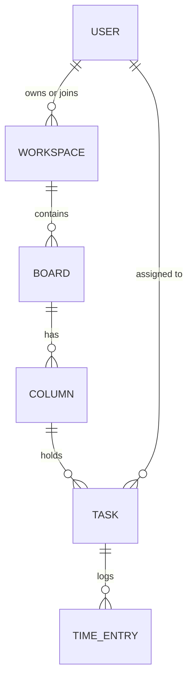

# TeamLine Backend

**REST API for a Kanban-style team workspace: boards, tasks, time tracking and reports.**
Built in the 144-hour TAQAT intensive training at Code Map.


[Live app](https://team-line-frontend-eight.vercel.app/) · [Frontend repo](https://github.com/Team-line/TeamLine-frontend)

---

## The problem

Small teams track tasks across scattered tools, so ownership and status get lost.

TeamLine gives each team one workspace where tasks live on boards, every task has an owner, and the time spent on each task is recorded. Built for small teams and Arabic-speaking users.

## What the system does

- **Workspaces:** a team creates a workspace and adds members by email.
- **Boards and columns:** each workspace holds boards with custom columns (for example To Do, Doing, Done).
- **Tasks:** create, assign, move between columns and mark complete.
- **Time tracking:** start and stop a timer on a task, or add time by hand.
- **Reports:** a summary for any date range, exported as CSV or PDF.
- **Dashboard:** workspace stats, task distribution and daily productivity.
- **Accounts:** sign up, sign in, password reset by email.

## How the data fits together



## Engineering highlights

- **Two-token auth.** A 1-hour access token plus a 90-day refresh token, both in `httpOnly` cookies. A `Bearer` header also works.
- **Workspace roles.** Each member is `owner` or `member`. Only owners update or delete a workspace.
- **Fail-fast config.** Joi validates every environment variable at startup. A missing value stops the server with a clear message.
- **Layered modules.** Each feature has its own route, controller, service, repository and model files.
- **Security basics.** Helmet, CORS, and a rate limit of 20 requests per 15 minutes on auth routes.
- **Transactional email.** Password reset links sent through Resend.

**Size:** 8 modules, 52 endpoints under `/api/v1`.

## Tech stack

| Area | Tools |
|------|-------|
| Runtime and API | Node.js, Express 5 (ES modules) |
| Database | MongoDB, Mongoose 9 |
| Validation and auth | Joi, JWT, bcryptjs |
| Email | Resend |
| Reports | pdfkit (PDF), CSV export |

## Project structure

```text
src/
├── modules/
│   ├── auth/            # sign up, sign in, refresh, logout
│   ├── users/           # profile, password reset, search
│   ├── workSpace/       # workspaces and members
│   ├── Board/           # boards and columns
│   ├── tasks/           # tasks, moves, assignment
│   ├── time-tracking/   # timers and time entries
│   ├── reports/         # summaries, CSV and PDF export
│   └── dashboard/       # stats and charts data
├── shared/              # middlewares, errors, email templates
├── config/              # env validation, database, email client
├── app.js
└── server.js
```

## Run locally

```bash
git clone https://github.com/Team-line/TeamLine-Backend.git
cd TeamLine-Backend
npm install
npm run dev
```

Create a `.env` file first:

```env
PORT=3000
NODE_ENV=development
DB_CONNECTION=your_mongodb_connection_string
JWT_SECRET=your_secret_key
REFRESH_TOKEN_SECRET=your_refresh_secret_key
JWT_EXPIRE=7d
EMAIL_USER=your_email_address
EMAIL_PASSWORD=your_email_password
EMAIL_FROM=your_sender_address
RESEND_API_KEY=your_resend_api_key
```

## Team

Built by a team of five: 1 backend developer, 3 frontend developers and 1 UI/UX designer.

**Backend and team lead:** [Mohammed Ferwana](https://github.com/hammoudFerwana)
[LinkedIn](https://www.linkedin.com/in/mohammed-ferwana) · mohammedferwana2@gmail.com
